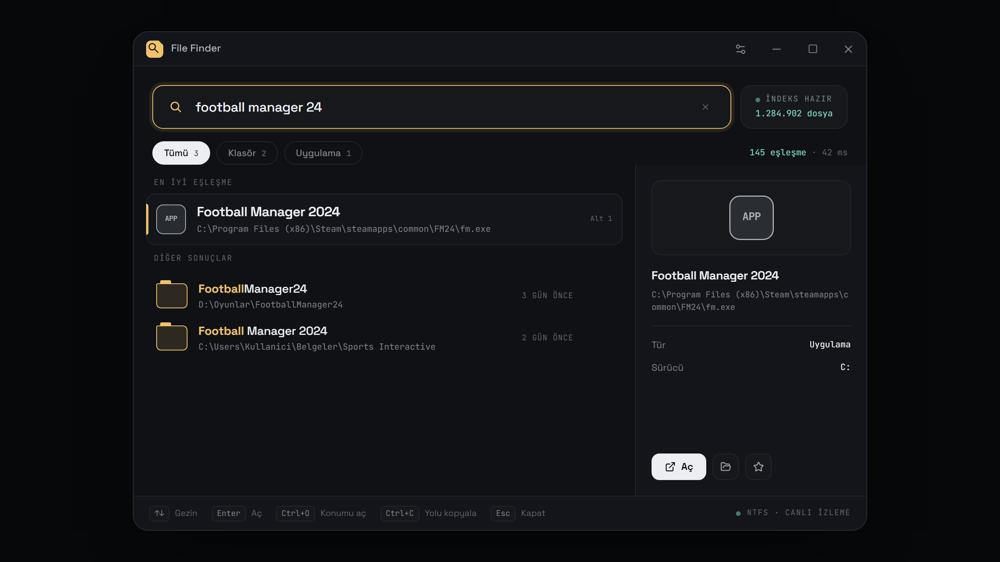
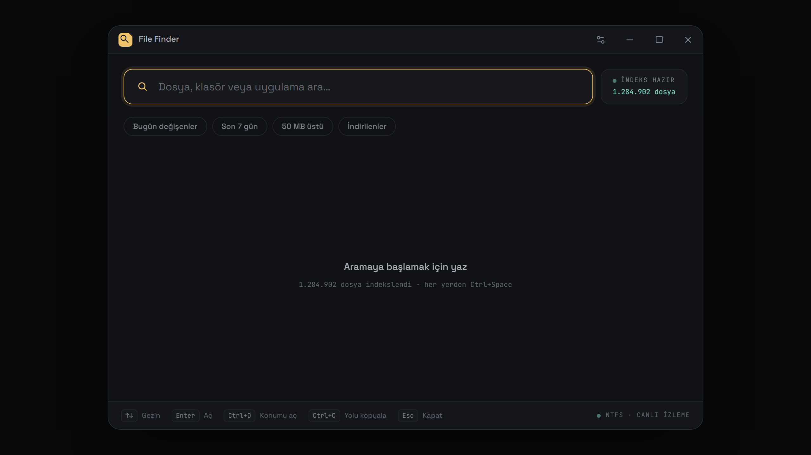
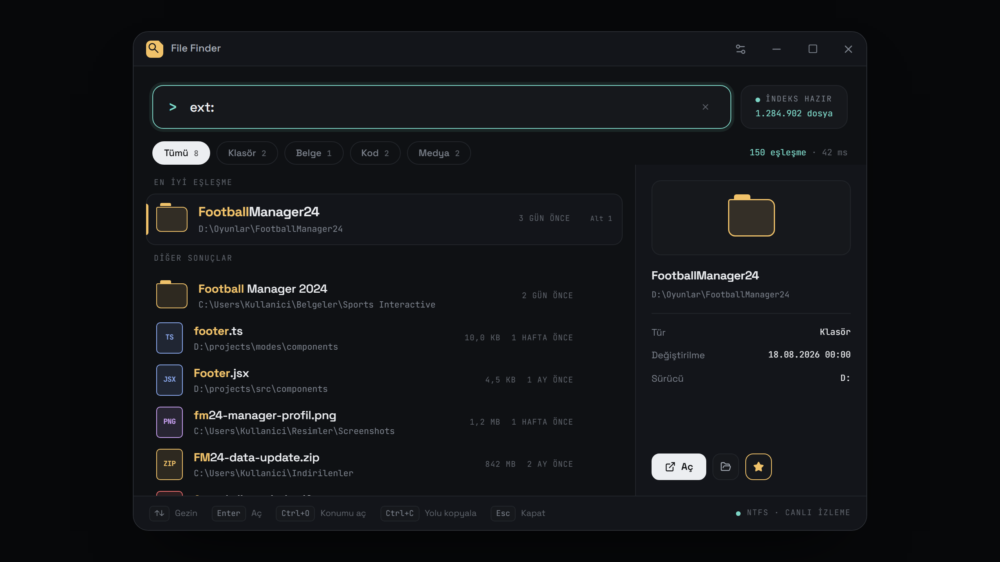
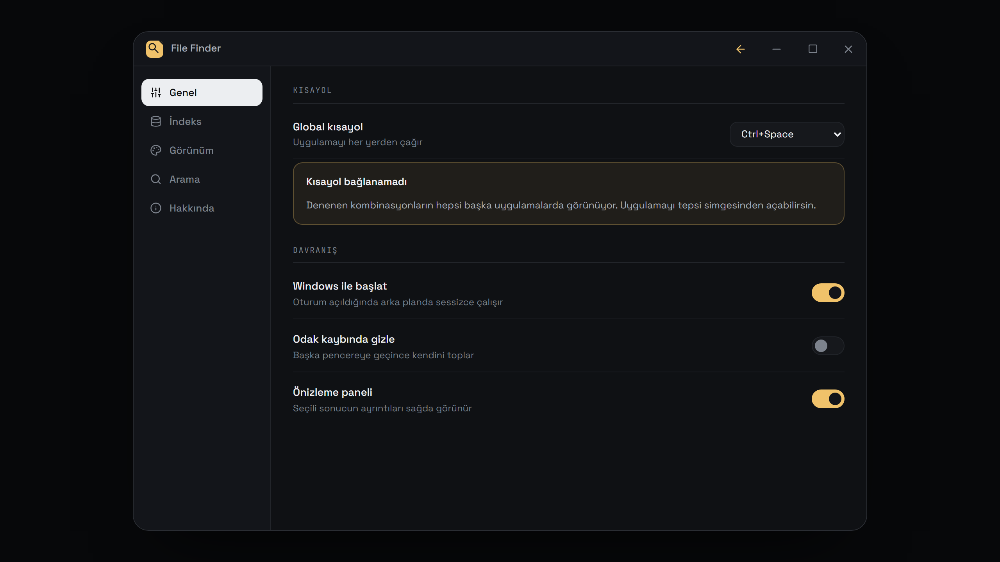
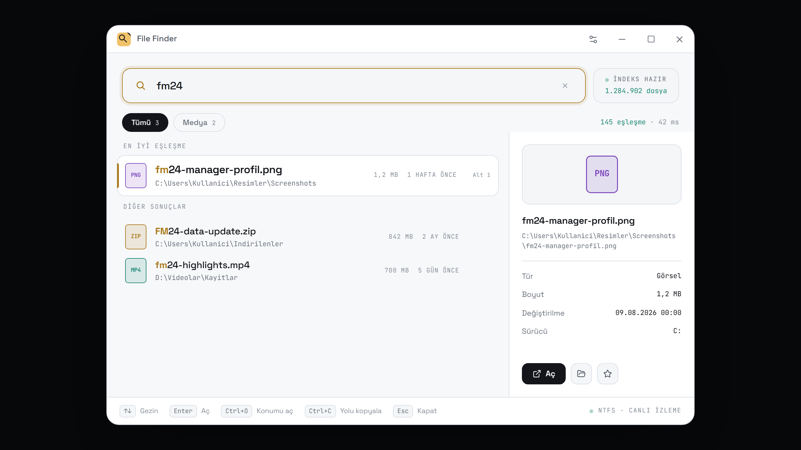

<div align="center">


# File Finder

**Windows için klavye odaklı, anlık dosya arama.**

Milyonlarca dosya arasından aradığını saniyenin altında bul. `Ctrl+Space` ile
her yerden çağır, yazmaya başla, `Enter`'a bas.

[](#kurulum)
[](https://tauri.app)
[](https://www.rust-lang.org)
[](https://react.dev)

[**Tanıtım sayfası**](https://berkdemir18.github.io/File-Finder/) ·
[**İndir**](https://github.com/berkdemir18/File-Finder/releases/latest)



</div>

---

## Ne yapar

Windows'un kendi aramasının aksine dosya sisteminde tek tek gezinmez — NTFS'in
kendi kayıt defterini (**MFT**) okuyup kendi indeksini tutar. Bu yüzden arama
diske değil, indekse gider.

- **Anlık sonuç.** 5 milyon dosyalık indekste tipik arama ~0,8 saniye; sonuçlar
  sen yazarken güncellenir.
- **Alaka sıralaması.** Tam eşleşme → baştan eşleşme → kısa isim. "footer"
  yazınca alfabenin başındaki dosyalar değil, gerçekten `footer` olan dosya gelir.
- **Boşlukları anlar.** `football manager 24` yazınca `FootballManager24`
  klasörünü bulur.
- **Uygulamaları da bulur.** Başlat menüsü ve kayıtlı programlar aramaya dâhil.
- **Canlı takip.** Arka plan servisi USN Journal'ı dinler; yeni dosya
  oluşturulduğu anda indekse girer.
- **Klavyeden çıkmadan.** Aç, konumunu aç, yolu kopyala, yönetici olarak
  çalıştır, geri dönüşüme gönder — hepsi kısayolla.

## Ekranlar

<table>
<tr>
<td width="50%">
<br>
<sub><b>Boş durum</b> — son aramalar, favoriler ve hızlı filtreler</sub>
</td>
<td width="50%">
<br>
<sub><b>Komut modu</b> — <code>ext:</code>, <code>size:</code>, <code>modified:</code> filtreleri</sub>
</td>
</tr>
<tr>
<td width="50%">
<br>
<sub><b>Ayarlar</b> — kısayol, tema, hassasiyet, davranış</sub>
</td>
<td width="50%">
<br>
<sub><b>Açık tema</b> — sistem temasını da izleyebilir</sub>
</td>
</tr>
</table>

## Kurulum

[Releases](https://github.com/berkdemir18/File-Finder/releases/latest)
sayfasından kurulum dosyasını indirip çalıştır.

> Paket imzalı olmadığı için Windows SmartScreen uyarı verebilir.
> **Ek bilgi → Yine de çalıştır** ile devam edebilirsin.

Canlı takip için arka plan servisini bir kez yönetici olarak kaydetmen gerekir:

```powershell
sc.exe create FileFinderService binPath= "$env:LOCALAPPDATA\File Finder\file-finder-service.exe" start= auto
sc.exe start FileFinderService
```

Servis çalışmıyorsa uygulama yedek tarama moduna düşer — çalışır, ama indeks
canlı güncellenmez.

## Klavye

| Tuş                 | İş                                          |
| ------------------- | ------------------------------------------- |
| `Ctrl+Space`        | uygulamayı çağır (ayarlanabilir)            |
| `↑` `↓` `PgUp/PgDn` | sonuçlar arasında gezin                     |
| `Enter`             | aç                                          |
| `Ctrl+Shift+Enter`  | yönetici olarak çalıştır                    |
| `Ctrl+O`            | dosya konumunu aç                           |
| `Ctrl+C`            | yolu kopyala                                |
| `Alt+1` … `Alt+9`   | n. sonucu aç                                |
| `Del`               | geri dönüşüme gönder                        |
| `Esc`               | önce aramayı temizle, sonra pencereyi gizle |

Sorgu kutusu boşken `↑` `↓` arama geçmişinde gezinir.

## Sorgu filtreleri

| Filtre           | Örnek                             |
| ---------------- | --------------------------------- |
| Uzantı           | `ext:pdf`                         |
| Boyut            | `size:>1gb` · `size:100kb-5mb`    |
| Değişim tarihi   | `modified:today` · `modified:<7d` |
| Oluşturma tarihi | `created:2026-01-01..2026-06-30`  |
| Yol              | `path:C:\Projeler`                |
| Düzenli ifade    | `/^rapor-\d+\.xlsx$/`             |

Filtreler birleşir. Yalnız filtre yazmak da geçerli bir aramadır — o durumda
sonuçlar en son değişene göre sıralanır.

## Derleme

Gerekenler: [Rust](https://rustup.rs) 1.77+, [Node](https://nodejs.org) 18+,
Windows SDK (ikonu exe'ye gömen `rc.exe` için) ve WebView2 Runtime.

```bash
git clone https://github.com/berkdemir18/File-Finder.git
cd File-Finder
npm --prefix file-finder-ui install
```

Arka plan servisi önce derlenir; Tauri onu kaynak olarak paketler:

```bash
cargo build --release -p file-finder-service
cp target/release/file-finder-service.exe file-finder-ui/src-tauri/
npx --prefix file-finder-ui tauri build
```

Çıktı `target/release/bundle/` altında msi ve nsis olarak üretilir.

Arayüzü tarayıcıda, Rust'ı hiç derlemeden görmek için:

```bash
npm --prefix file-finder-ui run dev
```

sonra <http://localhost:1420/preview.html> açılır. `src/dev/tauriMock.ts`
Tauri IPC'sini sınırından taklit eder, `App` bileşeni hiç değiştirilmeden
çalışır.

## Nasıl çalışıyor

```
┌──────────────────────┐   USN Journal   ┌─────────────────────┐
│  file-finder-service │◀───────────────▶│  NTFS · MFT         │
│  Windows servisi     │                 │  ana dosya tablosu  │
│  (Rust)              │                 └─────────────────────┘
└──────────┬───────────┘
           │  paylaşılan SQLite (WAL)
           ▼
┌──────────────────────┐
│  file-finder-ui      │  Tauri 2 · React 19
│  masaüstü uygulaması │  arama · sıralama · önizleme
└──────────────────────┘
```

Birkaç tasarım kararı:

- **SQLite yalnız _aday_ toplar** (2000 kayıt); asıl sıralamayı Rust tarafındaki
  fuzzy skor yapar. Adaylar alfabetik değil, alaka ihtimaline göre seçilir —
  yoksa "footer" araması alfabenin başındaki dosyalarda boğulur.
- **Aday toplama kapsayıcı indeksten yürür.** Ek filtre yoksa sorgu yalnız
  `(id, name)` çeker; isim indeksi bunu tek başına karşıladığı için SQLite
  3 GB'lık tabloya hiç inmez. Ölçüm (4,98M kayıt): **14,9 sn → 0,76 sn**.
- **Gerçek `COUNT(*)` çalıştırılmaz** — ikinci bir tam tarama demek olurdu.
  Aday havuzu dolduysa sayaç "2000+" yazar; kırpılmış sayıyı kesin sayı gibi
  göstermez.
- **Sayfalama sıralamadan sonra yapılır**, yoksa 2. sayfa bambaşka bir kümeyi
  yeniden sıralardı.

Ayrıntılar için [`file-finder-ui/README.md`](file-finder-ui/README.md).

## Bilinen sınırlar

- Yalnız **NTFS** sürücüler indekslenir; FAT32 ve exFAT diskler kapsam dışı.
- Servis kaydı elle yapılıyor — kurulum sihirbazı bunu henüz üstlenmiyor.
- Dosya *içeriğinde* arama yok, yalnız isim ve yol üzerinden.
- Kurulum paketi imzalı değil.

## Teşekkür

Arayüz ve mimari kararların bir kısmı yapay zekâ desteğiyle geliştirildi.
İkonlar [Lucide](https://lucide.dev); yazı tipleri
[Space Grotesk](https://fonts.google.com/specimen/Space+Grotesk) ve
[JetBrains Mono](https://www.jetbrains.com/lp/mono/).

## Lisans

[MIT](LICENSE)
